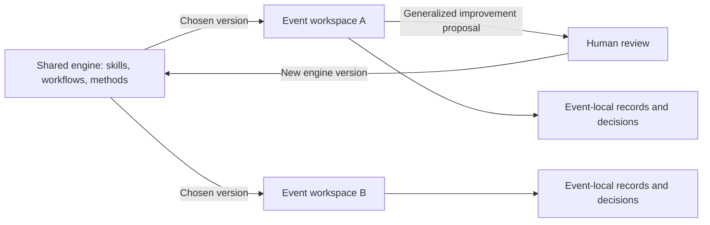

# Case study: turning recurring event work into a reusable engine

## The problem

Conference operations combine research with coordination. A plausible speaker suggestion is not yet a useful recommendation: an operator needs the source, evidence of the person's experience, relevance to the intended audience, and a clear account of what remains uncertain. Repeating this work across events also creates copies of procedures that drift apart.

I organized this work into reusable agent workflows, then separated the shared workflow layer from event-specific information.

## Architecture of the private project

The shared engine contains task definitions, research workflows, planning methods, decision records, and an event-workspace template. Each event retains its own working material and experiments. A shell script copies engine-managed assets at a selected Git ref into the locations expected by the agent tooling.

This is explicit versioned distribution, not a live multi-tenant backend. Updating a shared workflow does not automatically update every event. Event owners must choose when to take a new version, and maintainers must review changes before releasing them.

## Research design

The original JavaScript workflows separate discovery from verification. Discovery fans out over themes and research angles. Verification checks evidence for individual candidates before results are compiled. Research matrices also organize questions by business context and practitioner role.

Audience interviews provide a second source of grounding: an attractive topic should connect to a real audience need. A source-backed recommendation and the event owner's final decision are different states.

In the public demo, that distinction becomes `ready_for_review`, `pending`, and `rejected`. All checks are performed against a synthetic fixture. The local concurrency illustrates independent work units; it does not benchmark LLM orchestration.

## Design trade-offs

| Decision | Benefit | Cost or limitation |
| --- | --- | --- |
| Shared engine with event-local state | Reuse procedures without combining working records | Requires version management and clear ownership |
| Structured research results | Evidence gaps can be inspected | A schema cannot establish whether a source is true |
| Explicit pending state | Uncertainty stays visible | A person must resolve the remaining questions |
| Interview references at decision points | Topics remain connected to audience needs | Interviews require actual operator effort |
| Review before shared promotion | Local experiments do not silently become team defaults | Useful improvements can wait in a review queue |

## My contribution and evidence boundary

I built and organized the workflow system with AI coding assistants, including its reusable procedures, research orchestration, and engine/workspace separation. This public account is grounded in the private repository's workflow files, sync script, templates, and architecture records.

Those artifacts establish implementation scope. They do not establish how many people adopted the system, whether every integration worked in production, or a measured business impact. No such figures are asserted here.

The new Python demo makes a narrow part of the design executable and testable: incomplete or contradictory evidence cannot silently become a confirmed selection. It does not reproduce the private implementation or its complete feature set.

## What I learned

The useful unit of automation was a repeatable workflow with explicit inputs, evidence, outputs, and a decision owner. Sharing that unit required a distribution mechanism and an improvement path. Keeping uncertainty visible was as important as generating a polished answer.
